<a href="https://edifystudios.de"><picture><source media="(prefers-color-scheme: dark)" srcset="assets/dark/hero.svg"><source media="(prefers-color-scheme: light)" srcset="assets/light/hero.svg"></picture></a>

 

<picture><source media="(prefers-color-scheme: dark)" srcset="assets/dark/whoami.svg"><source media="(prefers-color-scheme: light)" srcset="assets/light/whoami.svg"></picture>

 

<picture><source media="(prefers-color-scheme: dark)" srcset="assets/dark/label-work.svg"><source media="(prefers-color-scheme: light)" srcset="assets/light/label-work.svg"></picture>

<picture><source media="(prefers-color-scheme: dark)" srcset="assets/dark/card-district.svg"><source media="(prefers-color-scheme: light)" srcset="assets/light/card-district.svg"></picture> <a href="https://edifystudios.de"><picture><source media="(prefers-color-scheme: dark)" srcset="assets/dark/card-edify.svg"><source media="(prefers-color-scheme: light)" srcset="assets/light/card-edify.svg"></picture></a>
<picture><source media="(prefers-color-scheme: dark)" srcset="assets/dark/card-skurllextv.svg"><source media="(prefers-color-scheme: light)" srcset="assets/light/card-skurllextv.svg"></picture> <picture><source media="(prefers-color-scheme: dark)" srcset="assets/dark/card-fxserver.svg"><source media="(prefers-color-scheme: light)" srcset="assets/light/card-fxserver.svg"></picture>

<a href="https://skurllex.tebex.io"><picture><source media="(prefers-color-scheme: dark)" srcset="assets/dark/card-scripts.svg"><source media="(prefers-color-scheme: light)" srcset="assets/light/card-scripts.svg"></picture></a>

 

<picture><source media="(prefers-color-scheme: dark)" srcset="assets/dark/activity.svg"><source media="(prefers-color-scheme: light)" srcset="assets/light/activity.svg"></picture>

 

<picture><source media="(prefers-color-scheme: dark)" srcset="assets/dark/stack.svg"><source media="(prefers-color-scheme: light)" srcset="assets/light/stack.svg"></picture>

 

<a href="mailto:hi@edifystudios.de"><picture><source media="(prefers-color-scheme: dark)" srcset="assets/dark/signoff.svg"><source media="(prefers-color-scheme: light)" srcset="assets/light/signoff.svg"></picture></a>

<a href="mailto:hi@edifystudios.de">hi@edifystudios.de</a> &nbsp;·&nbsp; <a href="https://edifystudios.de">edifystudios.de</a> &nbsp;·&nbsp; discord: skurllex

